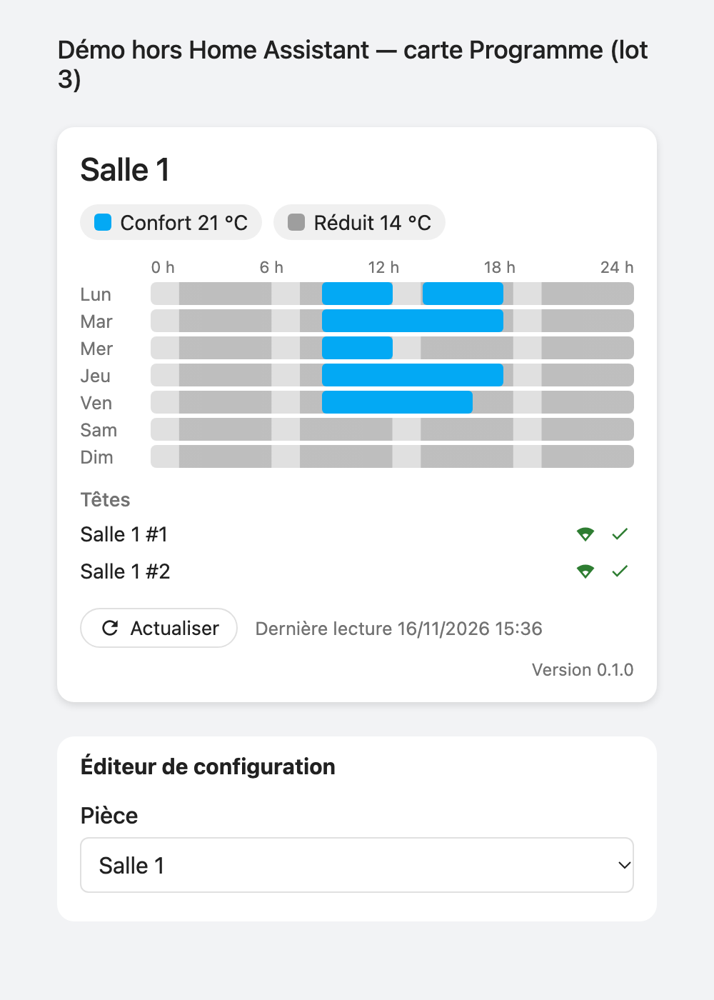

# Danfoss Ally (Cloud) — intégration Home Assistant

Intégration communautaire **non officielle** pour les têtes thermostatiques
Danfoss Ally, qui parle à la **même API cloud que l'application mobile** — sans
application développeur ni clé API, sans quota partagé.

Objectifs :
- mise en route simple (identifiants de l'app) ;
- toutes les fonctions du cloud, y compris celles absentes de l'API publique
  (programme hebdomadaire, détection de fenêtre, verrouillage enfant…) ;
- récupération automatique des **clés locales des passerelles** pour un accès
  Zigbee direct, sans émulateur ni Frida ;
- **publication MQTT** des appareils, en deux modes configurables : MQTT
  Discovery de HA, ou structure de topics compatible zigbee2mqtt.

## Avertissement

Projet indépendant, **non affilié à Danfoss ni à Tuya**. L'API cloud est
non documentée et obtenue par observation du protocole réseau de l'application.
Elle peut changer ou être coupée à tout moment, ce qui casserait l'intégration.
À utiliser à vos risques. Les mots de passe ne sont jamais demandés par Home
Assistant en dehors de l'écran de connexion de l'intégration.

## Installation (dépôt custom)

1. HACS → ⋮ → Dépôts personnalisés → ajouter `https://github.com/aghulas/ha-danfoss-ally` (catégorie Intégration).
2. Installer « Danfoss Ally (Cloud) », redémarrer Home Assistant.
3. Réglages → Appareils et services → Ajouter une intégration.

## Configuration

L'écran de configuration demande :

- **Identifiant / Mot de passe** : le compte de l'application Danfoss Ally / Smart Life.
- **Indicatif pays** : ex. `33` pour la France.
- **Datacenter** : `eu`, `us`, `cn` ou `in` (France → `eu`).
- **Secrets d'installation** : `sign_key`, `device_id` (`deviceId`), `ch_key` (`chKey`).

Les trois secrets d'installation sont propres à une installation de l'application et **se
capturent une fois** (ils restent stables ensuite). Ils sont indispensables à la signature et au
chiffrement de l'API mobile Tuya ; le serveur refuse un `chKey` inconnu. La méthode de capture est
décrite dans `docs/` (hook natif / capture réseau). Ces valeurs, le mot de passe et le matériel de
session (`sid`/`ecode`) sont des **secrets** : ils ne sont jamais écrits dans les journaux ni les
diagnostics (voir `diagnostics.py`).

> **Un seul client par jeu de secrets.** Côté serveur Tuya, ce triplet identifie une seule
> installation, donc une seule session active. Si le connecteur MCP `danfoss-ally-mcp` utilise le
> **même** triplet sur le même compte, les deux se délogent mutuellement : ne pas les faire tourner
> en parallèle, ou capturer un triplet distinct pour chacun. Détail dans
> [`docs/architecture.md`](docs/architecture.md) (« Session Tuya partagée avec le connecteur MCP »).

## Interface embarquée (carte de tableau de bord)

L'intégration **livre sa propre carte Lovelace** `danfoss-ally-schedule-card` (programme d'une
pièce). Rien à installer de plus : après l'installation par HACS et un redémarrage, la carte
apparaît directement dans le **sélecteur de cartes** (« Ajouter une carte »).



La carte affiche, en lecture, pour la pièce choisie : son nom, les consignes **confort** et
**réduit**, la **grille des sept jours** (plages de confort positionnées sur 24 h), l'**état des
têtes** (en ligne, programme actif, incohérente, en montage — icônes et infobulles), un bouton
**« actualiser »** et la **date de dernière lecture**. Thème clair / sombre par les variables de
Home Assistant, utilisable au clavier, textes traduits `en` / `fr`. L'édition viendra plus tard.

Comment ça marche :

- l'intégration sert son interface à l'URL `/danfoss_ally_cloud/frontend/` et déclare la ressource
  `…/danfoss-ally-cloud.js?v=<version>` pour les tableaux de bord **en mode stockage** (le mode par
  défaut) — aucune manipulation manuelle n'est nécessaire ;
- la carte vérifie sa version au chargement et **propose de recharger** la page quand une nouvelle
  version a été installée.

### Tableau de bord en mode YAML

En mode YAML, les ressources ne sont pas gérées par l'interface : ajoutez-la une fois à la main.

```yaml
# configuration.yaml (ou le fichier de ressources du tableau de bord)
lovelace:
  mode: yaml
  resources:
    - url: /danfoss_ally_cloud/frontend/danfoss-ally-cloud.js
      type: module
```

Puis, dans une carte manuelle :

```yaml
type: custom:danfoss-ally-schedule-card
room_id: "13000000" # group_id de la pièce
```

### Développer l'interface

Les sources TypeScript + Lit sont dans `frontend/`. Le bundle **est versionné** dans le dépôt
(`custom_components/danfoss_ally_cloud/frontend/danfoss-ally-cloud.js`) pour que HACS fonctionne
depuis n'importe quelle branche ou étiquette. Commande de build **exacte** (sortie déterministe,
vérifiée en CI) :

```bash
npm --prefix frontend ci
npm --prefix frontend run build   # régénère le bundle versionné
```

Autres commandes : `npm --prefix frontend test` (Vitest), `npm --prefix frontend run typecheck`,
et `npm --prefix frontend run demo` (page de démonstration hors Home Assistant, données d'essai
synthétiques, sur http://localhost:5173/demo/).

## État

**v0.1 — lecture seule cloud** : chaque tête apparaît comme un thermostat (température, consigne) ;
capteurs batterie, ouverture de vanne, code défaut ; capteurs binaires en ligne / fenêtre. Pas
encore d'écriture. Interface embarquée : carte `danfoss-ally-schedule-card` en **lecture**
(consignes, grille hebdomadaire, état des têtes, actualisation). Voir `docs/roadmap.md`.
